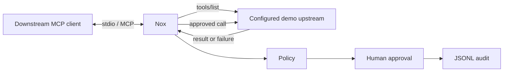

# Nox

Nox is a prototype MCP stdio security proxy that discovers upstream tools and
guards their execution with policy, human approval, privacy-conscious audit
logging, and failure handling.

## How it works



At startup, Nox connects to the upstream demo MCP server and validates its
complete tool list. It exposes the discovered names, descriptions, and input
schemas downstream, then routes calls by tool name. Each call is checked by
the allow/deny policy first; configured sensitive tools then require explicit
terminal approval. Calls are audited without arguments or results. Upstream
failures and local timeouts become safe MCP tool errors, and calls are not
retried because they may have side effects.

Nox currently launches the fixed local demo server
`npx tsx src/demo-server.ts`. It is not yet a general upstream command
launcher, remote MCP gateway, authentication layer, or production service.

## Features

- Dynamic upstream MCP tool discovery and metadata exposure.
- Exact-name allow/deny policy rules and `NOX_DENY_TOOLS` compatibility denies.
- Fail-closed human approval for configured sensitive tools.
- Serialized, privacy-conscious JSONL audit events.
- Configurable upstream call timeout and safe failure responses.
- MCP protocol messages on stdout; diagnostics on stderr.

## Prerequisites and commands

Requires Node.js 18 or newer and npm.

```sh
npm ci
npm run build
npm test
npm run demo-client
```

`npm run demo-client` starts the demo client, which starts Nox; Nox starts the
demo upstream server. The demo client prints the discovered tools and calls
`greet`.

## Configuration

Nox optionally reads `nox-policy.json` from the working directory. Set
`NOX_POLICY_FILE` to use another file. An explicitly selected file must exist
and validate.

```json
{
  "allow": ["greet", "farewell"],
  "deny": ["dangerous-tool"],
  "approval": ["farewell"],
  "approvalTimeoutMs": 30000,
  "upstreamTimeoutMs": 30000
}
```

Rules use exact tool names. `NOX_DENY_TOOLS` is a comma-separated deny
override. Denies are evaluated before the allow list; a non-empty `allow`
list denies tools not listed. Policy denial always precedes approval and
upstream execution.

Approval prompts are written to stderr and read from `/dev/tty` (or
`CONIN$` on Windows), never from the MCP protocol stdin. `y` or `yes` is
required; rejection, EOF, unavailable input, malformed input, and timeout all
fail closed. Prompts are serialized. `NOX_APPROVAL_INPUT_FILE` exists only
for non-interactive test harnesses.

Audit events default to `nox-audit.jsonl`; set `NOX_AUDIT_FILE` to override the
path. Events contain a UTC timestamp, sanitized tool name, policy decision,
outcome, and safe reason or approval status. Arguments, results, secrets,
environment values, and raw exceptions are not written. Audit write failures
produce a stderr warning and may leave an event missing.

`upstreamTimeoutMs` controls how long Nox waits for an upstream call. The
installed MCP stdio transport does not guarantee cancellation when this local
deadline wins, so upstream work may continue in the background. Nox does not
retry timed-out or failed calls.

## Development roadmap

### Stage 1 — Security gateway core

- [x] MCP proxy and tool forwarding
- [x] Configurable allow/deny policies
- [x] Human approval gate for sensitive tools
- [x] Privacy-conscious audit logging
- [x] Dynamic upstream tool discovery
- [x] Upstream timeout and failure handling

### Stage 2 — Real MCP integrations

- [ ] Configurable upstream server commands and arguments
- [ ] Support for real local stdio MCP servers
- [ ] End-to-end test with a real MCP server and compatible client
- [ ] Document server configuration and operational limitations

### Stage 3 — Remote support and hardening

- [ ] Remote Streamable HTTP transport, including authentication where appropriate
- [ ] Security tests for malformed input, secrets handling, and failure cases
- [ ] Reproducible demo and security documentation

The Stage 2 and Stage 3 items are intentionally incomplete; Nox is a
prototype until real upstream configuration and an end-to-end external
integration are implemented.
